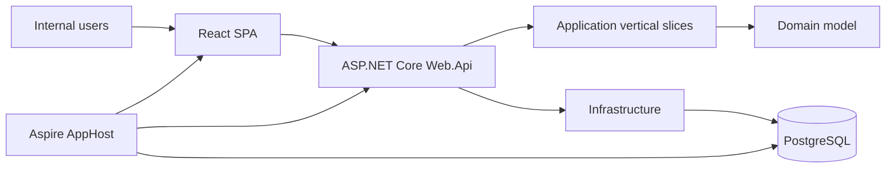
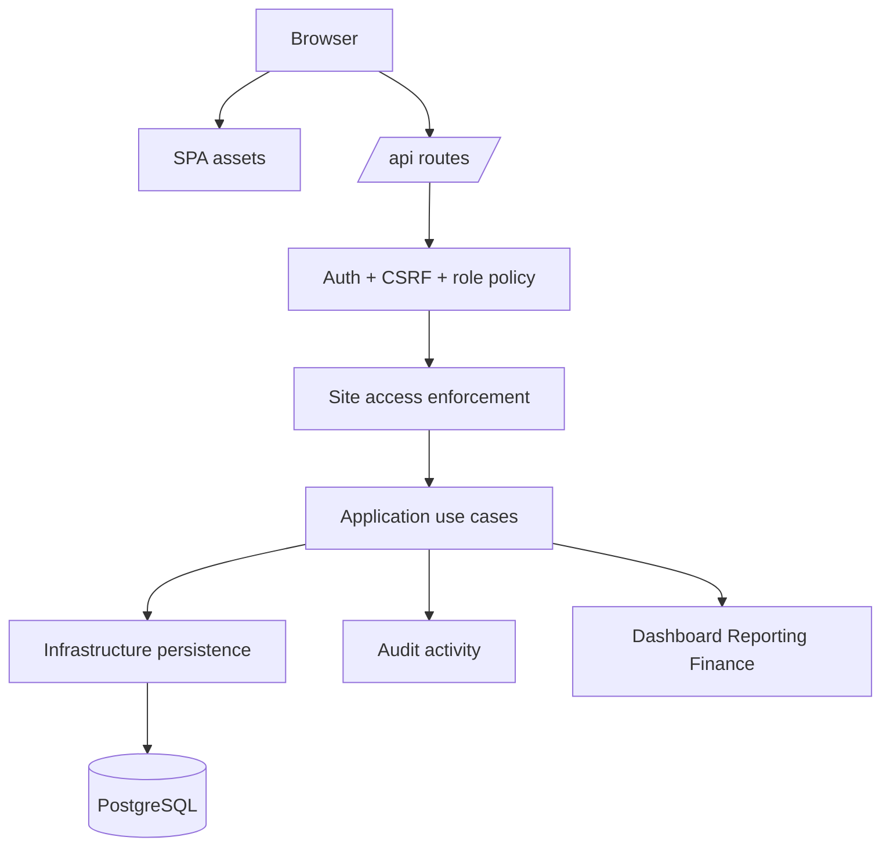
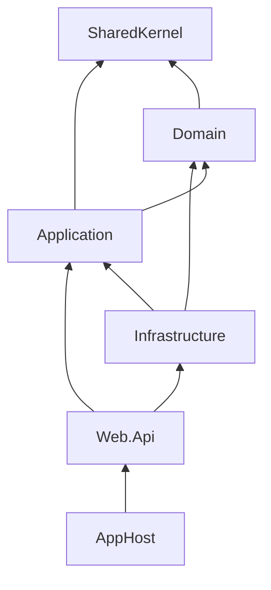
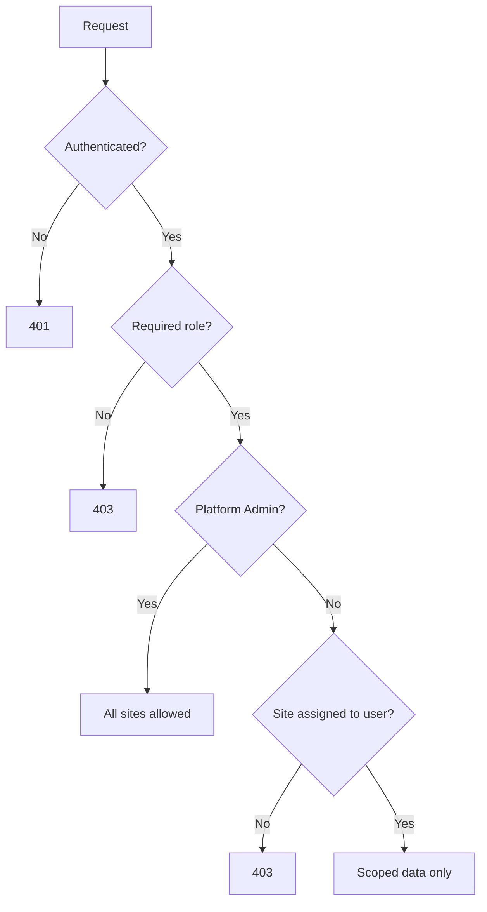
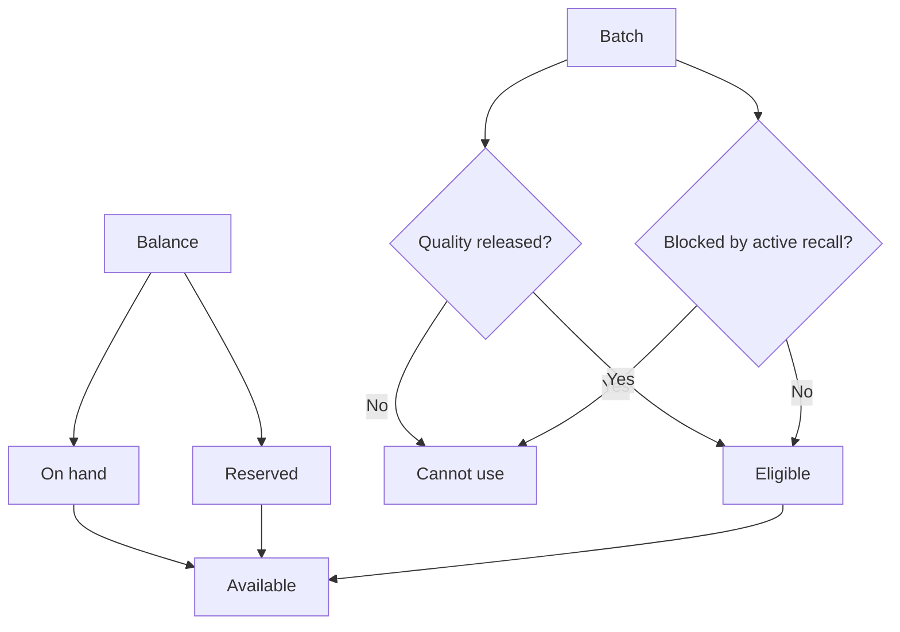
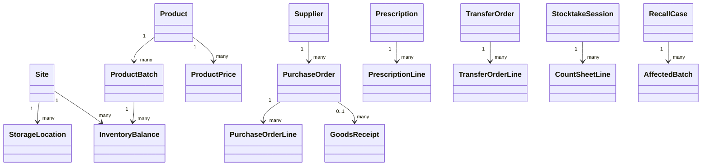

# Pharmacy Central Architecture

## Purpose

This document explains the current implemented architecture of Pharmacy Central. It is not a future proposal. Use it to understand how the running application is structured, where code belongs, and which architectural rules must stay true when the product changes.

## Current system shape

Pharmacy Central is a single internal web application for pharmacy and warehouse operations. It uses one React SPA, one ASP.NET Core backend, PostgreSQL, and Aspire for local orchestration.



## Implemented stack

| Area | Current implementation |
| --- | --- |
| Frontend | React, TypeScript, Vite, custom CSS, lightweight in-app routing |
| Backend | ASP.NET Core minimal endpoint groups, cookie auth, antiforgery, role policies |
| Application | Clean Architecture plus vertical slice use-case folders |
| Domain | Entities and workflow statuses for operational business rules |
| Data | PostgreSQL through EF Core migrations and EF Core persistence |
| Local orchestration | .NET Aspire AppHost with PostgreSQL and frontend resources |
| Packaging | Dockerfile and docker-compose for local production-like validation |
| Verification | Product-level API verification script under `tests/` |

Do not add stack claims to this document unless the library, service, or workflow exists in the repository.

## Runtime topology



## Code architecture decision

Pharmacy Central uses a hybrid of:

1. **Modular monolith** — one deployable backend with internal business boundaries.
2. **Clean Architecture** — dependency direction protects domain/application logic from frameworks.
3. **Vertical Slice Architecture** — each use case owns the code that changes together.



### Dependency rules

- `Domain` contains entities, statuses and stable business concepts.
- `Application` contains use-case orchestration and abstractions.
- `Infrastructure` implements persistence, identity, authorization support and technical adapters.
- `Web.Api` maps HTTP requests to application use cases and applies transport-level policy.
- `Domain` and `Application` must not reference EF Core, ASP.NET Core, Web.Api, or Infrastructure.

## Vertical slice layout

Application features are organized by capability and use case:

```text
src/Application/<Feature>/<UseCase>/
  Command.cs or Query.cs
  Handler.cs
  Details.cs or Response.cs

src/Application/<Feature>/Shared/
  Feature-family services, models or policies
```

Examples:

```text
src/Application/Inventory/ListInventoryBalances/
src/Application/Inventory/RecordStockMovement/
src/Application/Prescriptions/CreatePrescription/
src/Application/Procurement/CreatePurchaseOrder/
src/Application/Recalls/UpdateRecallStatus/
```

Endpoint files are grouped under:

```text
src/Web.Api/Endpoints/<Feature>/
```

Endpoints should stay thin: auth policy, site access, request mapping, current-user extraction and response mapping only.

## Access model

The backend enforces both role policy and site access.



| Policy area | Roles |
| --- | --- |
| AnyRole | Platform Admin, Pharmacy Manager, Pharmacist, Warehouse Staff |
| Management | Platform Admin, Pharmacy Manager |
| Store | Platform Admin, Pharmacy Manager, Pharmacist |
| Warehouse | Platform Admin, Warehouse Staff |
| PlatformAdmin | Platform Admin only |

Site-bound list endpoints filter data by assigned site IDs for non-admin users. Site-bound write endpoints reject unassigned sites.

## Main business modules

| Module | Current responsibility |
| --- | --- |
| Identity and access | Login, roles, site scopes, account controls |
| Sites and locations | Site master data and storage location setup |
| Catalog and suppliers | Product and supplier master data |
| Pricing | Draft/publish/archive prices and active price lookup |
| Procurement | Purchase orders and lifecycle status |
| Receiving | Supplier delivery capture and optional PO matching |
| Quality | Batch release/reject before operational use |
| Inventory | Balances, availability, history and controlled corrections |
| Prescriptions | Reservation, cancellation and dispensing |
| Transfers | Approve, ship and receive stock between locations |
| Returns/removals | Supplier returns, damage, expiry, recall or other removals |
| Stocktake/adjustments | Count sessions, variance posting and approval |
| Recalls | Recall cases and affected batch action tracking |
| Reporting/finance | Read-only operational visibility and valuation/reconciliation |
| Audit | Business activity traceability |
| Users | Internal user, role, site access and account controls |

## Stock availability controls



A batch is operationally usable only when it has available quantity, is quality-released, is not blocked by active recall, and the user has role/site access.

## Transaction and reliability rules

- EF Core migrations manage schema.
- `Web.Api` applies migrations on startup.
- Fresh Aspire dev databases bootstrap the EF migration history table before migration.
- Prescription creation reserves available stock.
- Prescription cancellation releases held quantity.
- Prescription dispensing consumes held quantity.
- Prescription create/dispense support `Idempotency-Key` retry behavior.
- Creator identity and approver identity are taken from authenticated claims, not request bodies.
- High-risk approvals block self-approval where required.
- Critical business actions write audit activity.

## Data model overview



## Deployment and packaging reality

The repository currently supports:

- Aspire local development.
- A single Web.Api container that serves the built frontend from `wwwroot`.
- A PostgreSQL container in `docker-compose.yml`.
- GitHub Act
