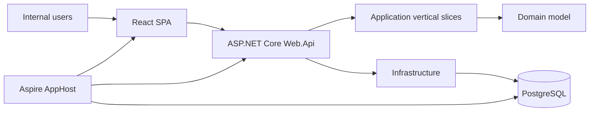
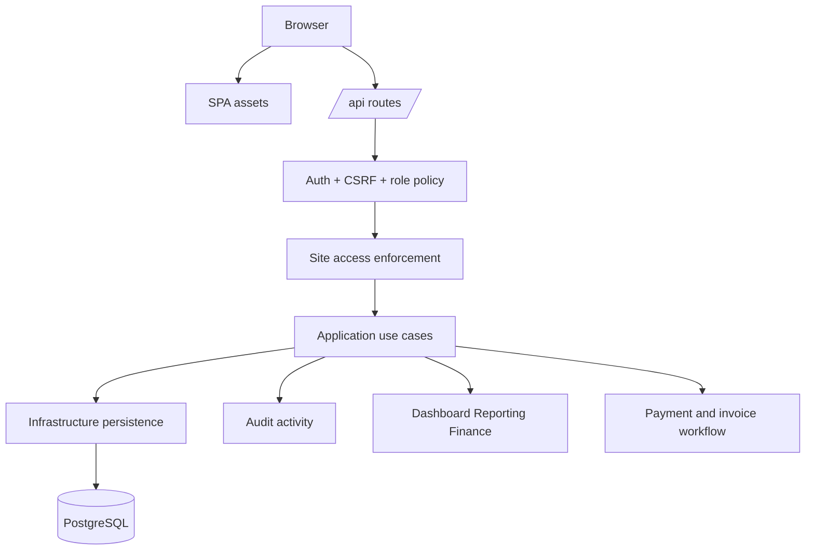
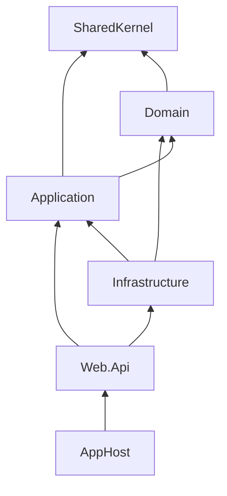
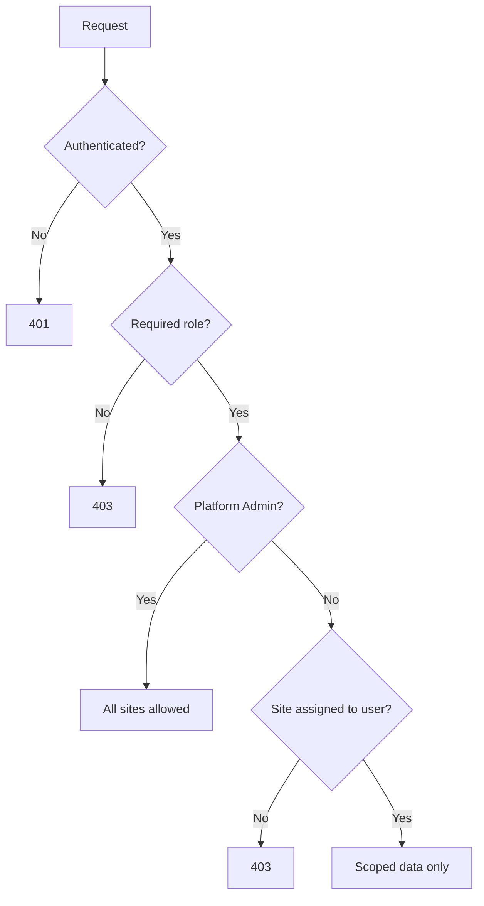
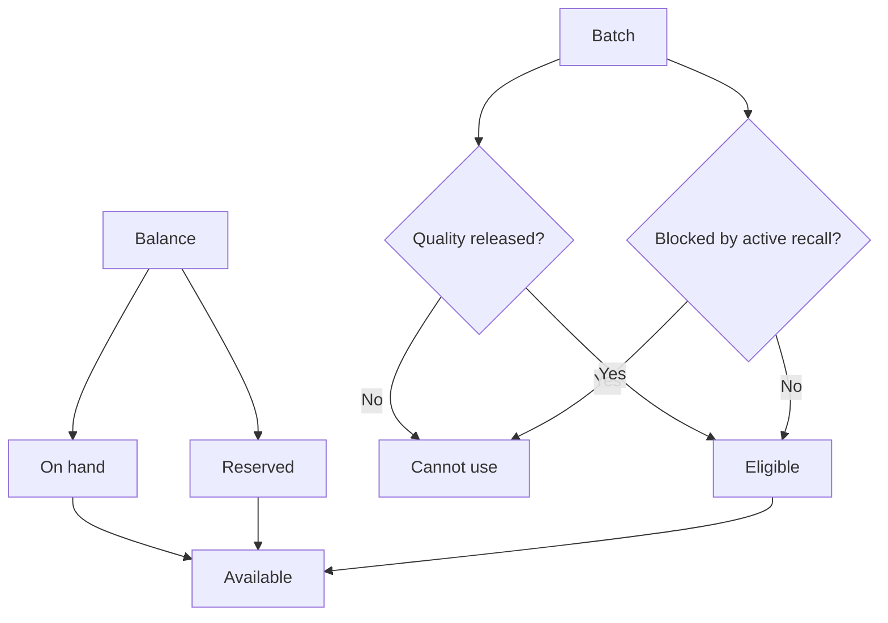
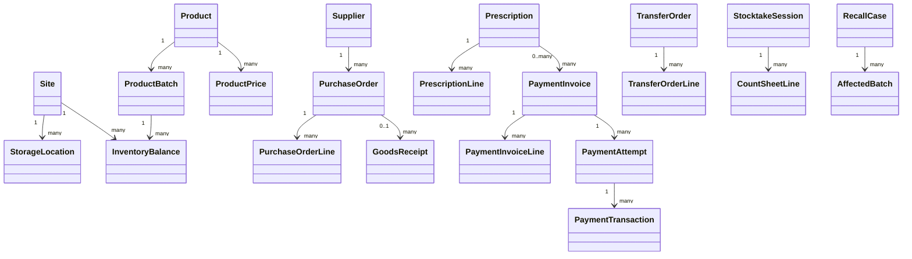
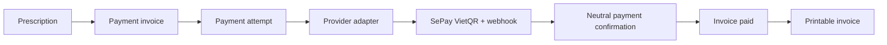

# Kiến trúc Pharmacy Central

## Mục đích

Tài liệu này mô tả kiến trúc đang được triển khai trong Pharmacy Central. Đây không phải proposal tương lai. Dùng tài liệu này để hiểu app đang chạy như thế nào, code thuộc về đâu và những quy tắc kiến trúc nào phải giữ đúng khi sản phẩm thay đổi.

## Hình dạng hệ thống hiện tại

Pharmacy Central là một web app nội bộ duy nhất cho vận hành nhà thuốc và kho. Hệ thống dùng một React SPA, một backend ASP.NET Core, PostgreSQL và Aspire cho local orchestration.



## Stack đang triển khai

| Area | Current implementation |
| --- | --- |
| Frontend | React, TypeScript, Vite, custom CSS, lightweight in-app routing |
| Backend | ASP.NET Core minimal endpoint groups, cookie auth, antiforgery, role policies |
| Application | Clean Architecture plus vertical slice use-case folders |
| Domain | Entities and workflow statuses for operational business rules |
| Data | PostgreSQL through EF Core migrations and EF Core persistence |
| Local orchestration | .NET Aspire AppHost with PostgreSQL and frontend resources |
| Packaging | Dockerfile and docker-compose for local production-like validation |
| Verification | Product-level API verification script under `tests/` |

Do not add stack claims to this document unless the library, service, or workflow exists in the repository.

## Topology runtime



## Quyết định kiến trúc code

Pharmacy Central uses a hybrid of:

1. **Modular monolith** — one deployable backend with internal business boundaries.
2. **Clean Architecture** — dependency direction protects domain/application logic from frameworks.
3. **Vertical Slice Architecture** — each use case owns the code that changes together.



### Quy tắc dependency

- `Domain` contains entities, statuses and stable business concepts.
- `Application` contains use-case orchestration and abstractions.
- `Infrastructure` implements persistence, identity, authorization support and technical adapters.
- `Web.Api` maps HTTP requests to application use cases and applies transport-level policy.
- `Domain` and `Application` must not reference EF Core, ASP.NET Core, Web.Api, or Infrastructure.
- Payment core must stay provider-neutral. External payment providers are adapters at the infrastructure/API boundary, not domain concepts.

## Bố cục vertical slice

Application features are organized by capability and use case:

```text
src/Application/<Feature>/<UseCase>/
  Command.cs or Query.cs
  Handler.cs
  Details.cs or Response.cs

src/Application/<Feature>/Shared/
  Feature-family services, models or policies
```

Examples:

```text
src/Application/Inventory/ListInventoryBalances/
src/Application/Inventory/RecordStockMovement/
src/Application/Prescriptions/CreatePrescription/
src/Application/Procurement/CreatePurchaseOrder/
src/Application/Recalls/UpdateRecallStatus/
src/Application/Payments/CreatePrescriptionPayment/
src/Application/Payments/ConfirmPayment/
src/Application/Payments/GetPrintableInvoice/
```

Endpoint files are grouped under:

```text
src/Web.Api/Endpoints/<Feature>/
```

Endpoints should stay thin: auth policy, site access, request mapping, current-user extraction and response mapping only.

## Mô hình truy cập

The backend enforces both role policy and site access.



| Policy area | Roles |
| --- | --- |
| AnyRole | Platform Admin, Pharmacy Manager, Pharmacist, Warehouse Staff |
| Management | Platform Admin, Pharmacy Manager |
| CounterSale | Pharmacist |
| Store | Pharmacist |
| Warehouse | Platform Admin, Warehouse Staff |
| PlatformAdmin | Platform Admin only |

Site-bound list endpoints filter data by assigned site IDs for non-admin users. Site-bound write endpoints reject unassigned sites.

## Module nghiệp vụ chính

| Module | Current responsibility |
| --- | --- |
| Identity and access | Login, roles, site scopes, account controls |
| Sites and locations | Site master data and storage location setup |
| Catalog and suppliers | Product and supplier master data |
| Pricing | Draft/publish/archive prices and active price lookup |
| Procurement | Purchase orders and lifecycle status |
| Receiving | Supplier delivery capture and optional PO matching |
| Quality | Batch release/reject before operational use |
| Inventory | Balances, availability, history and controlled corrections |
| Quầy bán thuốc và cấp phát | Chỉ Pharmacist tạo phiếu bán hiện tại, giữ hàng, thanh toán, hủy và cấp phát |
| Transfers | Approve, ship and receive stock between locations |
| Returns/removals | Supplier returns, damage, expiry, recall or other removals |
| Stocktake/adjustments | Count sessions, variance posting and approval |
| Recalls | Recall cases and affected batch action tracking |
| Reporting/finance | Read-only operational visibility and valuation/reconciliation |
| Payments/invoices | Provider-neutral payment invoice workflow, provider attempts, confirmations and printable invoices |
| Audit | Business activity traceability |
| Users | Internal user, role, site access and account controls |

## Kiểm soát lượng hàng có thể dùng



A batch is operationally usable only when it has available quantity, is quality-released, is not blocked by active recall, and the user has role/site access.

## Quy tắc giao dịch và độ tin cậy

- EF Core migrations manage schema.
- `Web.Api` applies migrations on startup.
- Fresh Aspire dev databases bootstrap the EF migration history table before migration.
- Current sale ticket creation reserves available stock.
- Current sale ticket cancellation releases held quantity.
- Dispensing consumes held quantity.
- Current sale ticket create/dispense support `Idempotency-Key` retry behavior.
- Creator identity and approver identity are taken from authenticated claims, not request bodies.
- High-risk approvals block self-approval where required.
- Critical business actions write audit activity.

- Payment invoices snapshot line prices at creation time so printable invoices remain stable after price changes.
- External payment confirmations are matched atomically by provider, payment code, amount and status.
- Payment providers are integrated through adapters. SePay is the first provider adapter for VietQR and webhook confirmation.

## Tổng quan data model



## Thực tế đóng gói và deployment

The repository currently supports:

- Aspire local development.
- A single Web.Api container that serves the built frontend from `wwwroot`.
- A PostgreSQL container in `docker-compose.yml`.
- GitHub Actions build validation only; no image push or real deployment step.

## Bootstrap và setup quản trị viên đầu tiên

For local/demo convenience, the seeder can create a development administrator. This is controlled by:

```env
PHARMACY_SEED_ADMIN_USER=true
PHARMACY_SEED_DEMO_USERS=true
PHARMACY_SEED_BUSINESS_DATA=true
```

When `PHARMACY_SEED_ADMIN_USER=false` and no Platform Admin exists, the login page switches into first-administrator setup mode. The first submitted administrator account is created once, signed in, and the setup mode is disabled because a Platform Admin now exists.

This keeps two supported paths: seeded development credentials for fast local work, and a first-run setup flow for validating a fresh workspace without demo users or business seed data.

## Kiến trúc thanh toán và hóa đơn

Payments are modeled as a provider-neutral business capability. The domain does not know about SePay, VietQR, webhook headers or any provider-specific payload shape. It only tracks invoices, invoice lines, payment attempts, transactions, provider identity and payment status.



SePay is the first provider adapter. Its responsibilities are generating provider-specific VietQR instructions, verifying `x-SePay-Signature`, parsing SePay webhook payloads, and mapping accepted inbound transfers to the neutral payment confirmation use case.

Core rules:

- `Domain/Payments` owns provider-neutral payment entities and statuses.
- `Application/Payments` owns payment creation, confirmation, status lookup and printable invoice use cases.
- `Infrastructure/Payments/SePay` owns SePay options, QR URL generation and HMAC verification.
- `Web.Api/Endpoints/Payments` exposes staff payment endpoints plus the SePay webhook adapter.
- Frontend screens render payment instructions returned by the API; they do not construct provider-specific QR URLs.

Refunds, void flows and external settlement posting remain outside the first payment/invoice implementation unless explicitly scoped later.
