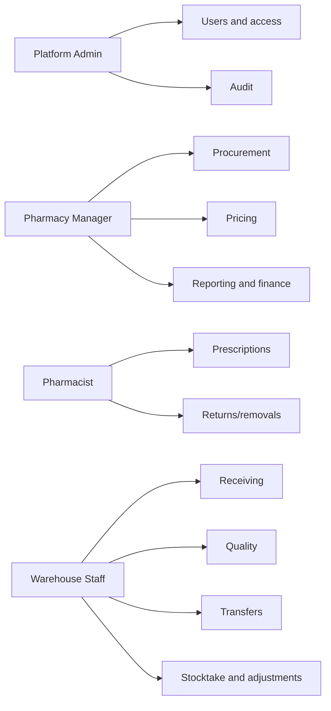
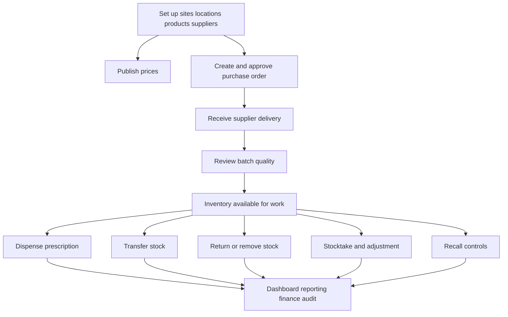

# Pharmacy Central Product Guide

## Purpose

This guide explains how the implemented Pharmacy Central app is used by internal teams. It combines user guidance and demo flow into one product-facing guide.

## Sign in

1. Start the app with Aspire or the local package.
2. Open the frontend URL from Aspire. In local AppHost testing, prefer `http://app.pharmacy.dev.localhost:5200/` when available.
3. Sign in with an assigned internal account.
4. The sidebar shows only workspaces allowed for the signed-in user's roles.

If the app starts with no configured administrator, the sign-in page shows a first-administrator setup form. Enter the administrator display name, email and password once. After that account exists, the page returns to normal sign-in for future sessions.

Seeded local development admin account, when admin seeding is enabled:

```text
Email: admin@pharmacy.local
Password: Admin@123!
```

The local development seed can also create these role-specific accounts when demo-user seeding is enabled:

| Purpose | Email | Password | Role | Site access |
| --- | --- | --- | --- | --- |
| Manager demo | `manager@pharmacy.local` | `Manager@123!` | Pharmacy Manager | HQ/store demo sites |
| Pharmacist demo | `pharmacist@pharmacy.local` | `Pharmacist@123!` | Pharmacist | Store demo sites |
| Warehouse demo | `warehouse@pharmacy.local` | `Warehouse@123!` | Warehouse Staff | Warehouse/store demo sites |

Use seeded credentials only in local development data.

## Not an admin-only app

Platform Admin sees every workspace, so the seeded admin account can make the app look admin-only. In normal use, work is split by role.



| Role | Typical workspaces |
| --- | --- |
| Platform Admin | All workspaces, user access management, audit |
| Pharmacy Manager | Sites, catalog, suppliers, pricing, procurement, reporting, finance, recalls |
| Pharmacist | Prescriptions, dispensing, inventory visibility, returns/removals |
| Warehouse Staff | Receiving, quality review, transfers, stocktake, adjustments |

Users can also be limited to assigned sites. Site-limited users only see and operate on their assigned sites.

## Main product journey



## Dashboard and reporting

Use **Dashboard** for operational totals, alerts and recent activity.

Use **Reporting** for broader operational visibility:

- inventory risk summary
- low-stock and near-expiry view
- recent activity
- activity breakdowns

Low-stock and near-expiry rules match the backend dashboard definitions.

## Master data

### Sites and storage locations

Use **Sites** to manage pharmacies, warehouses and related storage locations.

### Catalog

Use **Catalog** to manage product records such as SKU, name, unit, manufacturer and status.

### Suppliers

Use **Suppliers** to manage approved supplier records.

## Pricing

Use **Pricing** to prepare, publish and archive product prices.

Basic flow:

1. Create a draft price for a product.
2. Optionally scope it to one site, or leave it applicable to all sites.
3. Set unit price, currency and effective dates.
4. Publish the price when ready.
5. Archive old prices when they should no longer be used.

The app blocks overlapping published prices for the same product/site/effective period.

## Procurement and receiving

### Purchase orders

Use **Procurement** to create and manage purchase orders.

Basic flow:

1. Create a purchase order for a supplier, site, expected date and product quantities.
2. Approve the order.
3. Receive goods against the approved order from the Receiving page.
4. The order status updates as quantities are received.

### Goods receiving

Use **Receiving** to record supplier deliveries.

Basic flow:

1. Choose supplier, site, storage location and receipt number.
2. Optionally select an approved purchase order.
3. Enter received product, batch number, expiry date and quantity.
4. Submit the receipt.
5. Newly received batches wait for quality review before operational use.

## Quality review

Use **Quality** to review newly received batches.

- Release accepted batches so they can be used operationally.
- Reject batches that should not be used.
- Add review notes for traceability.

## Inventory

Use **Inventory** to view balances, available quantity and history.

The correction form is available for allowed users and records controlled quantity corrections.

## Prescriptions and dispensing

Use **Prescriptions** for dispensing workflows.

Basic flow:

1. Create a prescription with patient and line details.
2. The app holds available stock for the prescription.
3. Dispense when ready.
4. Dispensing consumes the held quantity and records activity.
5. Cancel if the prescription should not proceed; cancellation releases held quantity.

## Transfers

Use **Transfers** to move stock between sites/locations.

Basic flow:

1. Create a transfer from a source site/location to a destination site/location.
2. Approve with an eligible second user.
3. Ship the transfer.
4. Receive at the destination.

Self-approval is blocked for transfer approval.

## Returns and removals

Use **Returns** for supplier returns, damaged goods, expired goods, recalled goods, or other operational removals from available stock.

## Stocktake and adjustments

Use **Stocktake** to create count sessions, record counts and post resulting adjustments.

Use **Adjustments** to prepare and approve standalone stock adjustments. Approval requires an eligible user and records the decision.

## Recalls

Use **Recalls** to identify affected batches, activate recall controls, record batch actions and close or cancel recall cases.

Active recalls block affected batches from operational use until an allowed action releases or removes the batch.

## Finance reconciliation

Use **Finance** to review inventory valuation and operational reconciliation by site and date range. It summarizes current value from published prices, received quantities, dispensing, returns/removals, adjustments and transfers.

External accounting posting is not part of this workspace.

## Audit

Use **Audit** to review recorded business activity. Audit details are intended for operational traceability and oversight.

## User management

Platform Admin users can use **Users** to:

- view users
- create internal users
- assign roles
- assign site access
- update access
- reset a user's password when needed
- sign out a user's active sessions after access changes or suspected account misuse

## Demo path

Use this path for a compact local demo:

1. Sign in as the seeded development admin.
2. Open **Dashboard** and show totals, alerts and role-aware navigation.
3. Open **Sites**, **Catalog** and **Suppliers** to show master data.
4. Open **Pricing**, create a draft price and publish it.
5. Open **Procurement**, create and approve a purchase order.
6. Open **Receiving**, record a delivery against the order.
7. Open **Quality**, release the new batch.
8. Open **Inventory**, show available quantity and history.
9. Open **Prescriptions**, create and dispense a prescription.
10. Open **Transfers**, show create/approve/ship/receive lifecycle if a second eligible account is available.
11. Open **Returns**, show a return/removal reason.
12. Open **Stocktake** and **Adjustments**, show count sessions and approval workflow.
13. Open **Recalls**, create or inspect recall controls.
14. Open **Reporting**, **Finance** and **Audit** to show visibility and traceability.
15. Open **Users** to show role and site access management.

## Demo cautions

- Use local/development data only.
- Avoid real patient, supplier or staff information.
- Do not reuse development credentials outside development.
- If a workflow needs a second approver, create a dedicated demo user with the required role and site access.

## Good operating habits

- Use named staff accounts, not shared accounts.
- Keep site access narrow for users who only work at specific sites.
- Review quality, recall, stock adjustment and audit records regularly.
- Use development seed credentials only in development environments.
