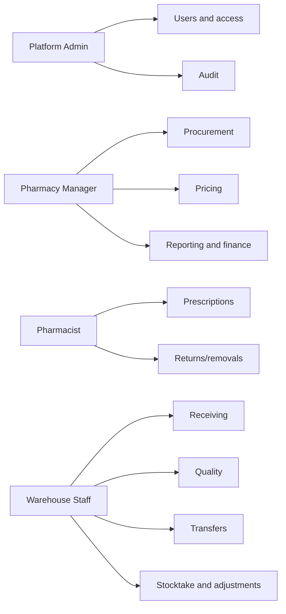
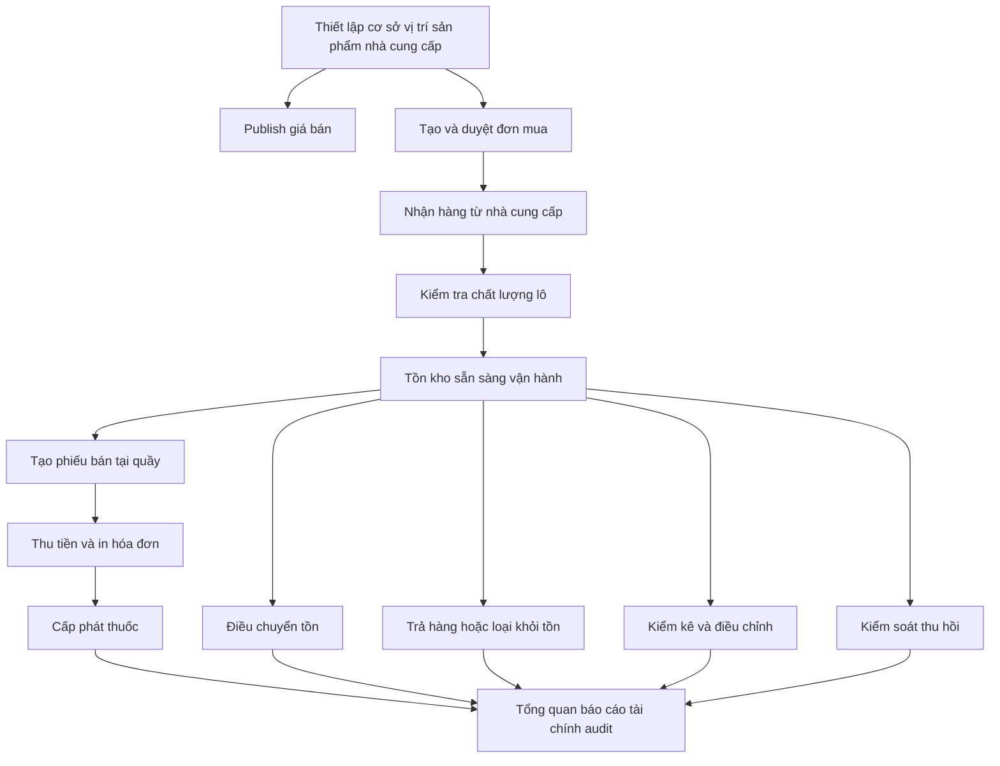

# Hướng dẫn sử dụng Pharmacy Central

## Mục đích

Tài liệu này mô tả cách các nhóm nội bộ sử dụng Pharmacy Central theo đúng vai trò nghiệp vụ đã triển khai. Nội dung viết theo hướng vận hành thực tế, không mô tả app như một màn hình admin tổng quát.

## Đăng nhập

1. Khởi động app bằng Aspire hoặc gói chạy local.
2. Mở frontend URL từ Aspire. Khi test qua AppHost, dùng `http://app.pharmacy.dev.localhost:5200/` nếu có.
3. Đăng nhập bằng tài khoản nội bộ được cấp.
4. Sidebar chỉ hiển thị workspace phù hợp với role của tài khoản đang đăng nhập.

Nếu hệ thống chưa có quản trị viên đầu tiên, trang đăng nhập hiển thị form tạo quản trị viên đầu tiên. Sau khi tài khoản Platform Admin đầu tiên được tạo, hệ thống quay lại luồng đăng nhập bình thường.

Tài khoản admin local development khi bật seed admin:

```text
Email: admin@pharmacy.local
Password: Admin@123!
```

Khi bật seed demo users, local seed cũng tạo các tài khoản theo role:

| Mục đích | Email | Password | Role | Site access |
| --- | --- | --- | --- | --- |
| Demo quản lý nghiệp vụ | `manager@pharmacy.local` | `Manager@123!` | Pharmacy Manager | HQ/store demo sites |
| Demo dược sĩ tại quầy | `pharmacist@pharmacy.local` | `Pharmacist@123!` | Pharmacist | Store demo sites |
| Demo nhân sự kho | `warehouse@pharmacy.local` | `Warehouse@123!` | Warehouse Staff | Warehouse/store demo sites |

Các tài khoản seed chỉ dùng cho môi trường local development/demo.

## App không phải app admin-only

Pharmacy Central có bốn role nghiệp vụ. Platform Admin quản trị hệ thống, không phải nhân sự đứng tại hiệu thuốc. Dược sĩ mới là người xử lý giao dịch tại quầy bán thuốc.



| Role | Workspace chính |
| --- | --- |
| Platform Admin | Users, phân quyền, audit, giám sát hệ thống |
| Pharmacy Manager | Sites, catalog, suppliers, pricing, procurement, reporting, finance, recalls |
| Pharmacist | Quầy bán thuốc, thanh toán, cấp phát, xem tồn kho, trả hàng/loại bỏ |
| Warehouse Staff | Receiving, quality, transfers, stocktake, adjustments |

User không phải Platform Admin còn bị giới hạn theo site được gán. User chỉ xem và thao tác dữ liệu thuộc phạm vi site của mình.

## Luồng sản phẩm chính



## Tổng quan và báo cáo

Dùng **Dashboard** để xem tổng quan vận hành, cảnh báo và hoạt động gần đây.

Dùng **Reporting** để xem rộng hơn về vận hành:

- tổng hợp rủi ro tồn kho
- hàng sắp thiếu và hàng gần hết hạn
- hoạt động gần đây
- phân nhóm hoạt động

Quy tắc hàng sắp thiếu và gần hết hạn phải khớp định nghĩa backend dashboard.

## Dữ liệu nền

### Cơ sở và vị trí lưu trữ

Dùng **Sites** để quản lý nhà thuốc, kho và vị trí lưu trữ liên quan.

### Danh mục sản phẩm

Dùng **Catalog** để quản lý mã sản phẩm, tên, đơn vị, nhà sản xuất và trạng thái.

### Nhà cung cấp

Dùng **Suppliers** để quản lý nhà cung cấp được duyệt.

## Định giá

Use **Pricing** to prepare, publish and archive product prices.

Basic flow:

1. Create a draft price for a product.
2. Optionally scope it to one site, or leave it applicable to all sites.
3. Set unit price, currency and effective dates.
4. Publish the price when ready.
5. Archive old prices when they should no longer be used.

The app blocks overlapping published prices for the same product/site/effective period.

## Mua hàng và nhận hàng

### Đơn mua

Use **Procurement** to create and manage purchase orders.

Basic flow:

1. Create a purchase order for a supplier, site, expected date and product quantities.
2. Approve the order.
3. Receive goods against the approved order from the Receiving page.
4. The order status updates as quantities are received.

### Nhận hàng

Use **Receiving** to record supplier deliveries.

Basic flow:

1. Choose supplier, site, storage location and receipt number.
2. Optionally select an approved purchase order.
3. Enter received product, batch number, expiry date and quantity.
4. Submit the receipt.
5. Newly received batches wait for quality review before operational use.

## Kiểm tra chất lượng

Use **Quality** to review newly received batches.

- Release accepted batches so they can be used operationally.
- Reject batches that should not be used.
- Add review notes for traceability.

## Tồn kho

Use **Inventory** to view balances, available quantity and history.

The correction form is available for allowed users and records controlled quantity corrections.

## Quầy bán thuốc và cấp phát

**Quầy bán thuốc** là workspace chỉ dành cho **Pharmacist**. Platform Admin và Pharmacy Manager không đứng tại quầy và không tạo giao dịch với khách hàng. Mỗi dược sĩ xử lý một khách hiện tại tại POS terminal, không quản lý nhiều khách song song trên màn hình này.

Luồng cơ bản:

1. Hệ thống tự lấy cơ sở và vị trí bán hàng từ tài khoản/quầy được gán.
2. Dược sĩ tìm sản phẩm theo tên hoặc mã sản phẩm.
3. Dược sĩ thêm sản phẩm vào phiếu bán hiện tại và kiểm tra lô, hạn dùng, số lượng có thể bán và giá.
4. Thông tin khách hàng chỉ nhập khi cần. Mặc định là khách lẻ.
5. Tạo phiếu bán. Hệ thống giữ lượng hàng có thể bán cho giao dịch này.
6. Tạo thanh toán, hiển thị hướng dẫn thanh toán và in hóa đơn demo nếu cần.
7. Cấp phát sau khi thanh toán được xác nhận nếu luồng thanh toán đang bật.
8. Hủy phiếu nếu giao dịch không tiếp tục. Khi hủy, lượng hàng đã giữ được trả lại.

## Thanh toán và hóa đơn

Panel thanh toán nằm trong **Quầy bán thuốc** và phục vụ giao dịch hiện tại của dược sĩ.

Luồng cơ bản:

1. Tạo phiếu bán hiện tại tại quầy.
2. Tạo thanh toán cho phiếu hiện tại.
3. Hiển thị QR, nội dung chuyển khoản và tổng tiền cho khách.
4. Refresh hoặc chờ trạng thái thanh toán cập nhật sau khi khách thanh toán.
5. Khi thanh toán xác nhận thành công, in hóa đơn nếu khách cần.
6. Cấp phát thuốc trên cùng màn hình quầy.

Hóa đơn in từ trình duyệt gồm cơ sở, thời điểm lập hóa đơn, mã thanh toán, dòng sản phẩm, số lượng, đơn giá, tổng tiền và trạng thái thanh toán. Đây là luồng in demo bằng trình duyệt, không tích hợp máy in thật.

SePay Test mode trong môi trường development dùng để kiểm thử thanh toán mà không cần giao dịch thật với khách.

## Điều chuyển

Use **Transfers** to move stock between sites/locations.

Basic flow:

1. Create a transfer from a source site/location to a destination site/location.
2. Approve with an eligible second user.
3. Ship the transfer.
4. Receive at the destination.

Self-approval is blocked for transfer approval.

## Trả hàng và loại khỏi tồn

Use **Returns** for supplier returns, damaged goods, expired goods, recalled goods, or other operational removals from available stock.

## Kiểm kê và điều chỉnh

Use **Stocktake** to create count sessions, record counts and post resulting adjustments.

Use **Adjustments** to prepare and approve standalone stock adjustments. Approval requires an eligible user and records the decision.

## Thu hồi

Use **Recalls** to identify affected batches, activate recall controls, record batch actions and close or cancel recall cases.

Active recalls block affected batches from operational use until an allowed action releases or removes the batch.

## Đối soát tài chính

Use **Finance** to review inventory valuation and operational reconciliation by site and date range. It summarizes current value from published prices, received quantities, dispensing, returns/removals, adjustments and transfers.

External accounting posting is not part of this workspace.

## Nhật ký hoạt động

Use **Audit** to review recorded business activity. Audit details are intended for operational traceability and oversight.

## Quản lý người dùng

Platform Admin users can use **Users** to:

- view users
- create internal users
- assign roles
- assign site access
- update access
- reset a user's password when needed
- sign out a user's active sessions after access changes or suspected account misuse

## Luồng demo

Dùng luồng này để demo local ngắn gọn:

1. Đăng nhập bằng tài khoản admin local để kiểm tra quản trị user, audit và dữ liệu hệ thống.
2. Mở **Dashboard** để xem tổng quan, cảnh báo và navigation theo role.
3. Mở **Sites**, **Catalog** và **Suppliers** để xem dữ liệu nền.
4. Mở **Pricing**, tạo draft price và publish.
5. Mở **Procurement**, tạo và approve purchase order.
6. Mở **Receiving**, ghi nhận hàng về theo đơn mua.
7. Mở **Quality**, release lô hàng mới.
8. Mở **Inventory**, xem số lượng có thể dùng và lịch sử.
9. Đăng nhập bằng tài khoản **Pharmacist**, mở **Quầy bán thuốc**, tạo phiếu bán, thanh toán, in hóa đơn và cấp phát.
10. Open **Transfers**, show create/approve/ship/receive lifecycle if a second eligible account is available.
11. Open **Returns**, show a return/removal reason.
12. Open **Stocktake** and **Adjustments**, show count sessions and approval workflow.
13. Open **Recalls**, create or inspect recall controls.
14. Open **Reporting**, **Finance** and **Audit** to show visibility and traceability.
15. Open **Users** to show role and site access management.

## Lưu ý khi demo

- Use local/development data only.
- Avoid real patient, supplier or staff information.
- Do not reuse development credentials outside development.
- If a workflow needs a second approver, create a dedicated demo user with the required role and site access.

## Thói quen vận hành tốt

- Use named staff accounts, not shared accounts.
- Keep site access narrow for users who only work at specific sites.
- Review quality, recall, stock adjustment and audit records regularly.
- Use development seed credentials only in development environments.
