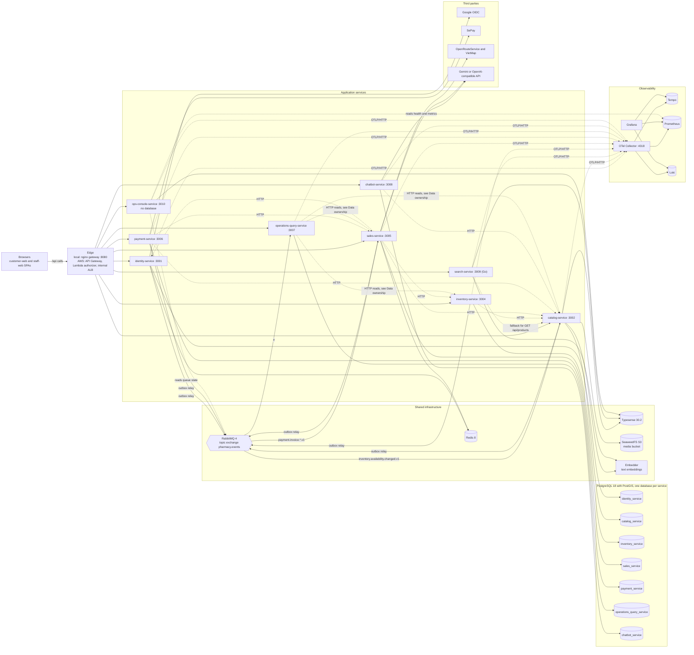

# Architecture

Last reviewed: 2026-10-26

This is the system map of Pharmacy Central: which parts exist, who owns what, and how they talk. It stays
high level on purpose. Detailed C4-style views live in the [LikeC4 model](diagrams/README.md), the rules
that are not negotiable live in [AGENTS.md](../AGENTS.md), and operations live in the [runbook](runbook.md).

## System map

Pharmacy Central is an Express 5 TypeScript microservices monorepo (Node.js 24, pnpm, Nx). One service is
written in Go: `search-service`, which serves only the product list. Two React and Vite single-page
applications, `customer-web` and `staff-web`, call the backend through `/api/...`.

Browsers never reach a backend service directly. Every `/api` request goes through one edge that uses the
same path routing map in both topologies: the Nginx `gateway` in local Compose, and the AWS API Gateway
with an internal Application Load Balancer (ALB) in production. The routing map is maintained in
[AGENTS.md](../AGENTS.md#path-routing-map) and implemented by
[deploy/local/gateway/routes.conf](../deploy/local/gateway/routes.conf) and by the listener rules in
[deploy/aws/main.tf](../deploy/aws/main.tf).

Each business service owns one PostgreSQL database. Services publish integration events to a RabbitMQ topic
exchange through a transactional outbox, and read each other's data through their HTTP contracts or through
events. Redis, Typesense, and SeaweedFS are shared infrastructure that individual services use for their own
purpose. The diagram below shows the logical architecture and is the only Mermaid diagram in this document.

## Services

Container ports are fixed in the Dockerfiles and Compose file. The host port of each service comes from the
`<SVC>_PORT` variable in `.env` (for example `IDENTITY_PORT`), and the ECS task uses the same container port.
Module-level detail is in the [LikeC4 domain views](diagrams/README.md#the-views).

| Service | Port | Owns | Talks to |
| --- | --- | --- | --- |
| `identity-service` | 3001 | Customer and employee accounts, opaque sessions, password security, email verification, Google OIDC. Schema `identity_service`. | PostgreSQL, Redis (auth rate limits), SMTP (Mailpit locally), RabbitMQ (outbox), Google OIDC |
| `catalog-service` | 3002 | Products, units, suppliers, sites, storage locations, prices, availability projections, the product search index, product media. Schema `catalog_service`. | PostgreSQL with PostGIS, Typesense (writes the index), SeaweedFS (S3), embedder, RabbitMQ (outbox; consumes `inventory.availability.changed.v1`) |
| `search-service` | 3009 | The read path of `GET /api/products` only. No database. | Typesense, embedder, `catalog-service` (fallback when Typesense cannot answer) |
| `inventory-service` | 3004 | Batches, stock, FEFO reservations, movements, transfers, returns, stocktakes, purchase orders, goods receipts, availability events. Schema `inventory_service`. | PostgreSQL, RabbitMQ (outbox), `catalog-service` (HTTP) |
| `sales-service` | 3005 | Guest and customer carts, orders, prescriptions, counter transactions, delivery calculation. Schema `sales_service`. | PostgreSQL, Redis (prescription intake limiter), RabbitMQ (outbox; consumes `payment.invoice.*.v1`), `catalog-service`, `inventory-service`, `identity-service` (HTTP), OpenRouteService, VietMap, AI prescription reader |
| `payment-service` | 3006 | Invoices, QR attempts, cash payments, SePay webhooks, refunds, reconciliation. Schema `payment_service`. | PostgreSQL, RabbitMQ (outbox), `sales-service` and `catalog-service` (HTTP), SePay |
| `operations-query-service` | 3007 | Read models for dashboards, finance, reports, and audit. Schema `operations_query_service`. | PostgreSQL, RabbitMQ (consumes `#` on `pharmacy.events`), HTTP reads of the owning services (see Data ownership) |
| `chatbot-service` | 3008 | Customer consultation assistant: chat sessions and catalog-grounded answers. Schema `chatbot_service`. | PostgreSQL, `catalog-service` (HTTP tool calls), Gemini or an OpenAI-compatible chat API |
| `ops-console-service` | 3010 | Read-only backend of the staff-web System page, Platform Admin only. No database. | Every service's health endpoint, Prometheus, RabbitMQ management API, Typesense |
| `customer-web` | 8080 in the container (`CUSTOMER_WEB_PORT` on the host) | Customer-facing React and Vite application, served by Nginx. | The edge, for `/api` |
| `staff-web` | 8080 in the container (`STAFF_WEB_PORT` on the host) | Internal staff portal, served by Nginx. | The edge, for `/api` |
| `gateway` (local only) | 8080 in the container (`GATEWAY_PORT` on the host) | Development path router. It is not used in production. | All backend services |

The AI settings of `chatbot-service`, `sales-service`, and `catalog-service` live in each service's
`ai_credentials` table, as described in the configuration section of [AGENTS.md](../AGENTS.md#configuration-and-environment-variables).

## Data ownership

The rules below apply to every change. The non-negotiable form is in [AGENTS.md](../AGENTS.md#architecture-and-service-boundaries).

- **Each business service owns its data.** `identity`, `catalog`, `inventory`, `sales`, `payment`,
  `operations-query`, and `chatbot` each own one PostgreSQL database, the schema, the Drizzle migrations
  under `apps/<service>/drizzle/migrations`, and their write models. Services that publish events also own
  their outbox table. Each service connects as its own role, `<service>_service`.
- **No service reads another service's database.** Cross-service data moves through the owning service's
  HTTP API, whose transport contracts live under the service's `src/contracts/` directory, or through
  integration events.
- **`search-service` owns no database** and reads only Typesense. It falls back to `catalog-service` when
  Typesense cannot answer.
- **`ops-console-service` owns no database.** It only reads other systems.
- **`operations-query-service` reads through integration events.** That is the rule. The current code also
  calls the owning services over HTTP for some summary figures (`apps/operations-query-service/src/modules/operations-repository.ts`
  calls `catalog-service`, `inventory-service`, and `sales-service`). The events-only rule is the target,
  and that HTTP usage is a known deviation to remove.
- **The browser is never authoritative.** Prices, stock quantities, delivery fees, distances, and the identity of
  the caller are recalculated by the owning service. Browser mutating requests need a valid CSRF token, except for
  the HMAC-verified SePay webhook.
- **The edge forwards identity, and services verify it.** The gateway forwards a signed internal identity
  context, as described in [README.md](../README.md#architecture). Role and site rules are in
  [docs/business-rules.md](business-rules.md) (BR-AUTH-*).

## Integration events

Integration events are the way services tell each other about changes they own without calling each other
synchronously. The exchange and the routes below are defined in the service code, not in configuration.

- **Exchange:** `pharmacy.events`, a durable topic exchange. Dead letters go to `pharmacy.events.dead`.
- **Producers:** `identity`, `catalog`, `inventory`, `sales`, and `payment`. Each one writes the event row in the
  same database transaction as the business change.
- **Flow:**
  1. A business transaction writes its change and an outbox row together. The row stores the `traceparent`
     of the request, so the trace continues across the broker.
  2. The outbox publisher of that service relays unpublished rows to `pharmacy.events` over a publisher-confirm
     channel, up to 500 rows per batch. It marks a row published only after the broker confirms it. An advisory
     lock allows one relay per database at a time, which keeps the order. Delivery is therefore at least once.
  3. Each consumer binds its own durable quorum queue and processes one message at a time. Consumers stay
     idempotent through their inbox or projection keys.
  4. A message that keeps failing is retried five times and then parked on `<queue>.dead` through
     `pharmacy.events.dead`. A payload that can never be applied is parked at once.
- **Current consumers:**

  | Queue | Consumer | Binding |
  | --- | --- | --- |
  | `catalog.availability.v2` | `catalog-service` | `inventory.availability.changed.v1` |
  | `sales.payment-events.v2` | `sales-service` | `payment.invoice.*.v1` |
  | `operations-query.events.v2` | `operations-query-service` | `#` |

Operational detail for the exchange, the queues, and the parking queues is in the
[runbook's messaging section](runbook.md#messaging-operations). HTTP contracts are in the [API Guide](api-guide.md).
A new event or a change to an existing event contract requires a design document, see
[docs/design/README.md](design/README.md).

## Deployment topologies

Both topologies run the same Docker images and the same contracts. Details are in the
[runbook](runbook.md#rollback-and-deployment) and the [deployment views](diagrams/README.md#the-views).

| Aspect | Local Docker Compose | AWS ECS Fargate |
| --- | --- | --- |
| Entry | `customer-web` and `staff-web` containers, Nginx `gateway` on `GATEWAY_PORT`. `gateway-dev` (host network) replaces it while services run through `pnpm dev`. | API Gateway HTTP API with a Lambda authorizer and a CSRF Lambda, a VPC Link, and an internal ALB |
| Compute | One container per backend service, built from `apps/Dockerfile.service` (`apps/search-service/Dockerfile` for `search-service`). Migrations run before each service starts. | One ECS Fargate service per backend, one embedder task, and one-shot migration tasks |
| Data | PostgreSQL (PostGIS 18), RabbitMQ 4.3, Redis 8.10, Typesense 30.2, SeaweedFS 4.48, embedder, Mailpit | RDS PostgreSQL, ElastiCache Redis, Amazon MQ for RabbitMQ, a Typesense cluster or Typesense Cloud, and Secrets Manager. The first stack does not provision these data services. |
| Telemetry | `otel-collector` with Tempo, Prometheus, Loki, and Grafana | An ADOT collector task that forwards to Amazon Managed Service for Prometheus, AWS X-Ray, and CloudWatch Logs |
| Status | Development and integration | Configuration only. No AWS resource has been created. |

The local stack is started with `pnpm run infra:up` (infrastructure plus `gateway-dev`) or
`pnpm run stack:up` (full container stack). Commands are listed in the [runbook](runbook.md).

## Observability

- Every backend service exports OTLP/HTTP to the collector through `OTEL_EXPORTER_OTLP_ENDPOINT`. Locally that
  is `otel-collector:4318`.
- The collector sends traces to Tempo (with span metrics and a service graph), metrics to Prometheus through its
  OTLP receiver, and logs to Loki.
- Grafana is the dashboard layer over Tempo, Prometheus, and Loki. Outbox and queue metrics (`pharmacy_outbox_*`)
  feed the business health dashboard.
- The staff-web System page reads health and queue state through `ops-console-service`.
- Alert handling and dashboard bookmarks are in the [runbook](runbook.md#observability). The telemetry edges are
  in the [observability view](diagrams/README.md#the-views).

## Related documents

- [AGENTS.md](../AGENTS.md): non-negotiable rules, repository layout, the path routing map, and verification.
- [LikeC4 model](diagrams/README.md): detailed logical and deployment diagrams (`pnpm diagrams:serve`).
- [Runbook](runbook.md): local operations, migrations, messaging, observability, and rollback.
- [API Guide](api-guide.md): HTTP contracts of the routes.
- [Business rules](business-rules.md): domain rules.
- [Architecture decisions](adr/README.md) and [design documents](design/README.md): how decisions are recorded.
